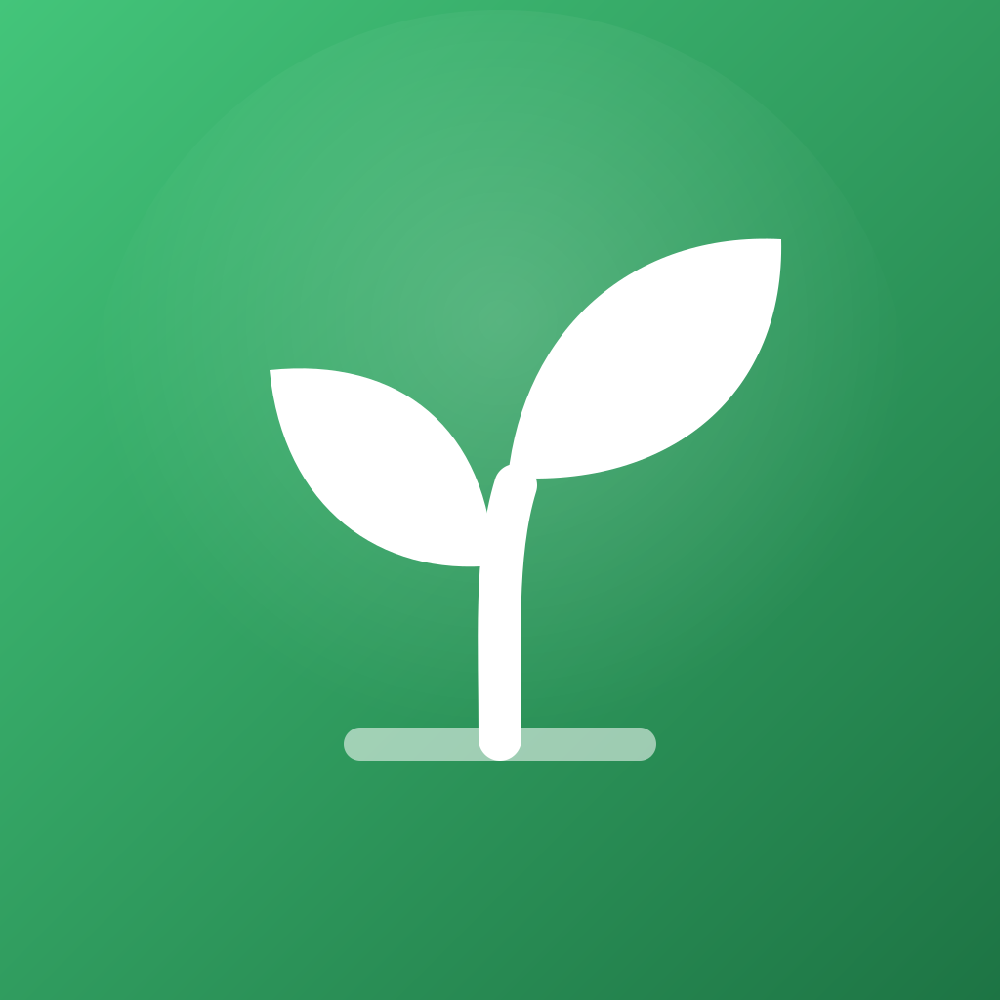

# 🌱 Your Growth (Mobile App)

A simple daily check-in app that helps you stay consistent. Answer one question each day, see your history, and get a nudge before you miss two days in a row.

**Backend:** [your-growth-backend](https://github.com/udit065/your-growth-backend)



## Features
- **Daily check-in**: "Did I try today?" → "What's one thing you did for yourself?"
- **Add a missed day**: log yesterday (or any day in the last week) if you forgot
- **Edit or delete** any entry
- **Daily reminder notification** at a time you pick, skipped on days you've already checked in, with a "Don't miss twice" message if you skipped yesterday
- **Streaks**: current streak, best streak, this month, and a last-7-days strip
- **History** grouped by month, with how many days you showed up
- **Offline-first and instant**: entries are cached on the phone, changes save immediately and sync in the background
- Light and dark mode

## Tech stack
React Native 0.88 · Expo SDK 58 (Router, Notifications, Haptics) · AsyncStorage · Day.js · TypeScript

## Run locally (Expo Go)
```bash
npm install
npx expo start
```
Scan the QR code with **Expo Go** (it must be the version for SDK 58), with your phone on the same Wi-Fi as your computer.

In Expo Go on Android, reminders are turned off because Expo Go can't create notification channels, and the app shows Expo Go's icon instead of its own. Both work in a real build.

To use a local backend instead of the live one, create `.env.local` with:
```
EXPO_PUBLIC_API_URL=http://<your-computer-ip>:5000
```

## Build the installable app (EAS)
```bash
npx eas build -p android --profile preview      # APK to install directly
npx eas build -p android --profile production   # AAB for the Play Store
```
Installed, the app is called **Your Growth** and uses the sprout icon.

## Where data is stored
- **On the phone** (AsyncStorage): a cache of all entries plus a queue of changes not yet uploaded. Screens always render from this cache, so they open instantly, even offline.
- **In the cloud** (MongoDB Atlas, via the API on Render): the main copy. The app uploads queued changes and refreshes the cache when it opens, when it comes back to the foreground, and on pull-to-refresh.
- Settings shows the sync status. If the server can't be reached, changes stay queued on the phone and upload later. Each install (Expo Go, the APK) has its own cache, but they all share the same data once synced.

## Project layout
```
app/(tabs)/index.tsx      Today: check-in, streaks, last 7 days
app/(tabs)/history.tsx    History grouped by month
app/(tabs)/settings.tsx   Reminder time, sync status
app/entry/[date].tsx      Add / edit / delete an entry for a day
lib/store.ts              Offline-first cache + sync queue
lib/api.ts                API client
lib/notifications.ts      Daily reminder scheduling
constants/theme.ts        Light and dark colours
```

## Author
**Udit Yadav** · [GitHub](https://github.com/udit065) · [LinkedIn](https://www.linkedin.com/in/udit-yadav065)
